<div align="center">

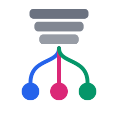

# stackfork

### Tus branches. Tu laptop. Todo corriendo a la vez.

Corre cada app que creas con IA, en tantas versiones como quieras, todas a la vez en tu propia computadora, sin que ninguna estorbe a las demás.

[English](README.md) · [Português](README.pt-BR.md) · **Español**

[](https://github.com/pedropinheiro75/stackfork/actions/workflows/ci.yml)


[](LICENSE)

[Cómo se ve](#cómo-se-ve) · [Instalación](#instalación) · [Cómo lo usas](#cómo-lo-usas) · [Cómo funciona](#cómo-funciona) · [Agentes](#trabaja-con-agentes-de-código) · [Seguridad](#seguridad) · [FAQ](#faq) · [Roadmap](#roadmap) · [Documentación](#documentación)

</div>

> Esta página es una traducción del [README en inglés](README.md). Si hay diferencias, el texto en inglés es el correcto.

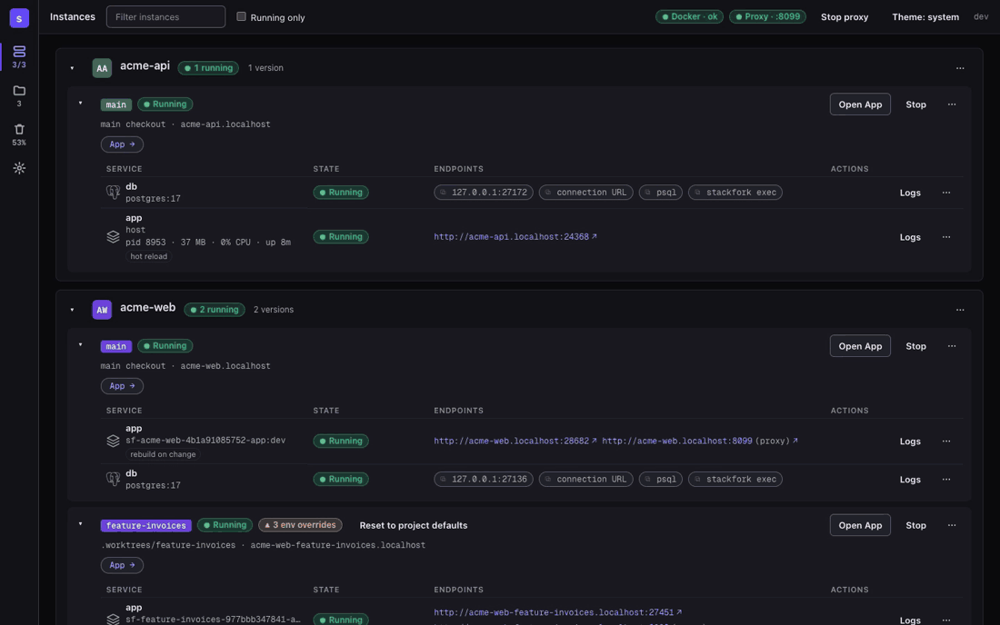

**El problema.** Le das una branch a un agente de IA y sigues trabajando en otra. Los dos corren `docker compose up`. Los mismos puertos, los mismos nombres de contenedor, los mismos volúmenes, muchas veces la misma base de datos. Uno de ustedes rompe al otro, y el agente no se da cuenta.

**La solución.** stackfork aprende una vez cómo arranca tu proyecto y guarda la receta en el repositorio: qué corre en Docker, qué corre en el host, qué instalar, migrar y poblar, y qué URL abrir. Desde entonces, cada worktree arranca con un solo comando, con sus propios puertos, volúmenes, red y URL `.localhost`. Cinco agentes y tú pueden trabajar en cinco branches de un mismo proyecto en una sola laptop, y nada choca.

## Cómo se ve

<picture>
  <source media="(prefers-color-scheme: dark)" srcset="docs/screenshots/instances-overview-dark.png">
  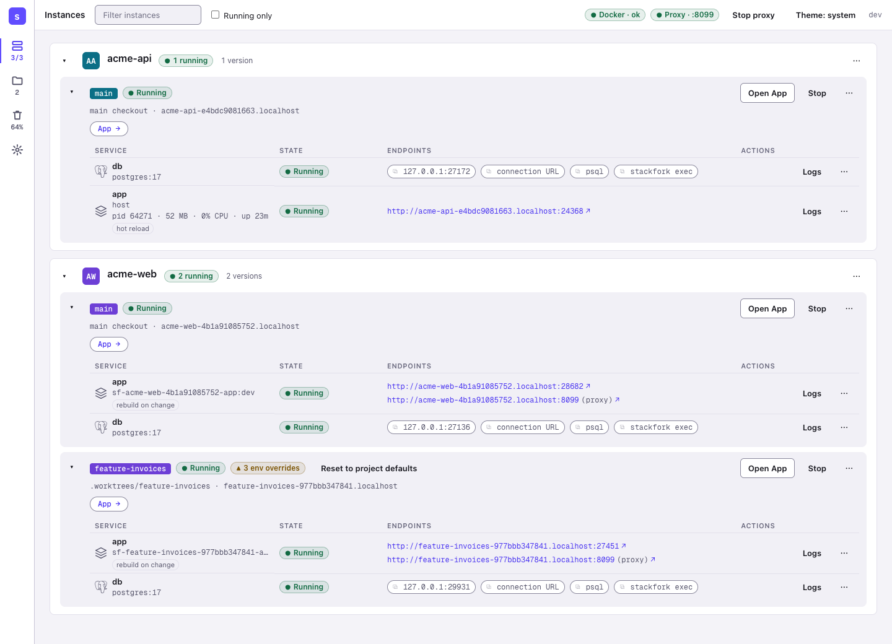
</picture>

**Vista general.** Dos proyectos, tres copias corriendo. `acme-api` corre su app en el host con hot reload y su base de datos en Docker. `acme-web` corre `main` y `feature-invoices` lado a lado, cada uno con su URL, puerto de base de datos y overrides de env.

<table>
<tr>
<td width="50%">
<picture>
  <source media="(prefers-color-scheme: dark)" srcset="docs/screenshots/instances-hybrid-host-app-dark.png">
  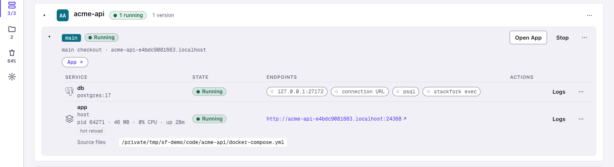
</picture>
</td>
<td width="50%">
<picture>
  <source media="(prefers-color-scheme: dark)" srcset="docs/screenshots/project-resources-dark.png">
  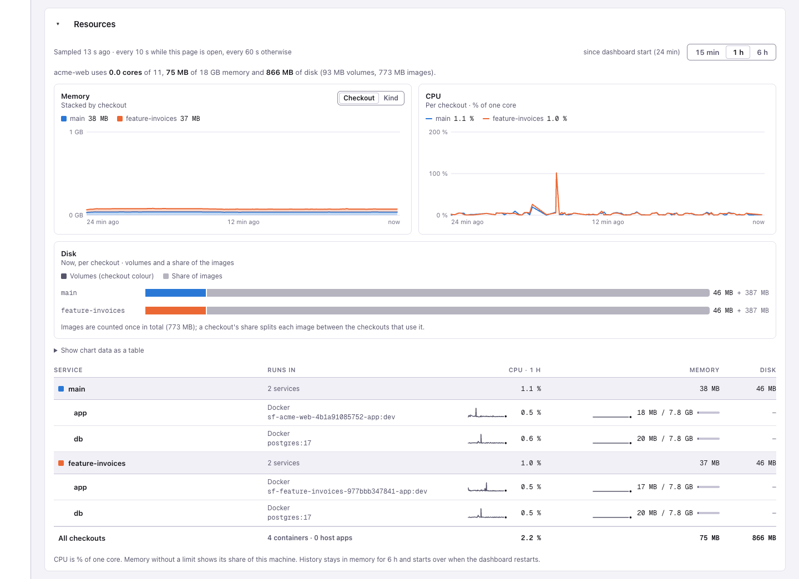
</picture>
</td>
</tr>
<tr>
<td><b>Instancia híbrida:</b> la base de datos corre en Docker y la app corre en el host con hot reload, con su PID, memoria y CPU a la vista.</td>
<td><b>Recursos:</b> memoria, CPU y disco de cada checkout, para que veas cuánto cuesta cada copia.</td>
</tr>
<tr>
<td width="50%">
<picture>
  <source media="(prefers-color-scheme: dark)" srcset="docs/screenshots/project-workflow-dark.png">
  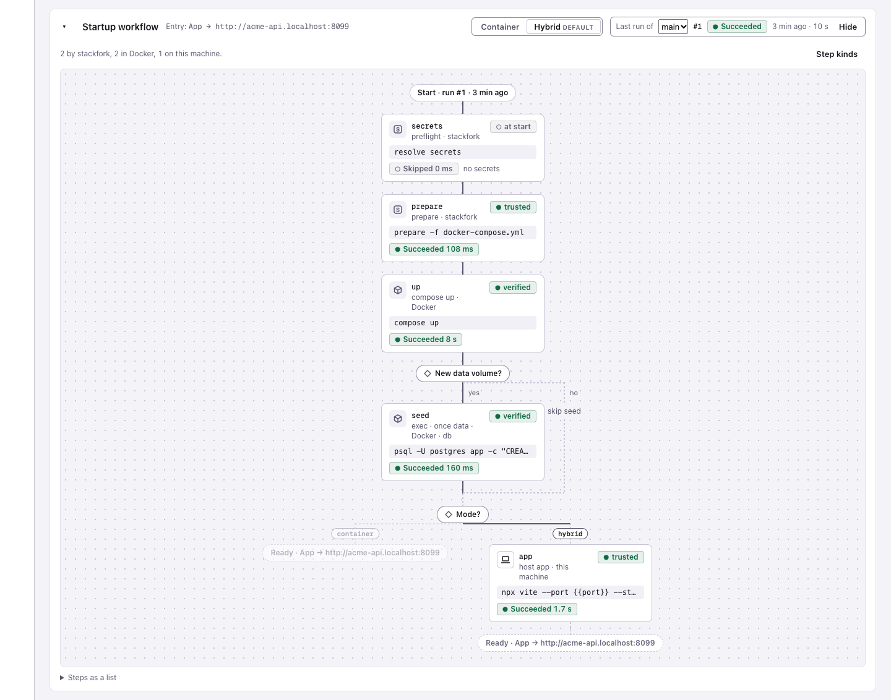
</picture>
</td>
<td width="50%">
<picture>
  <source media="(prefers-color-scheme: dark)" srcset="docs/screenshots/environment-dialog-dark.png">
  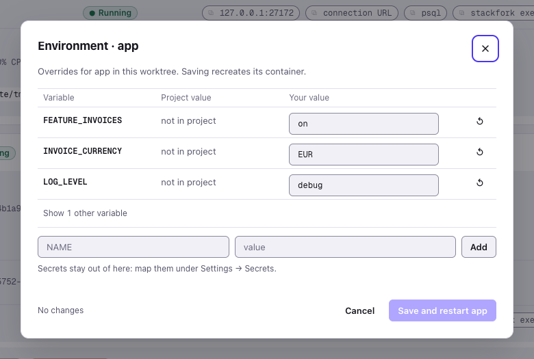
</picture>
</td>
</tr>
<tr>
<td><b>Flujo de inicio:</b> los pasos guardados de un proyecto, cada uno con el resultado de su última ejecución.</td>
<td><b>Entorno:</b> cambia una variable solo para un worktree, sin tocar el repositorio.</td>
</tr>
</table>

## Por qué lo siguen usando

| | |
|---|---|
| **Nada nuevo que mantener** | Lee el archivo Compose que ya mantienes y nunca lo edita. Si algo no se puede aislar con seguridad, te señala la línea. |
| **Hot reload y debugger, siempre aislados** | Deja Postgres y Redis en contenedores y corre la app en el host para tener hot reload y debugger. Cada branch sigue con su propia copia. |
| **Entornos que siguen tus pull requests** | `worktree add` + `start-env`, o activa el modo live y una nueva branch arranca sola. Haz merge o cierra el pull request, y el entorno desaparece. GitOps, en tu laptop. |
| **Configura una vez, para todo el equipo** | El plan de inicio es un archivo con commit. Tus compañeros y los agentes arrancan el proyecto de la misma manera, siempre. |
| **Los agentes corren libres, las personas tienen las llaves** | Los agentes inician, prueban y detienen entornos por su cuenta. Borrar datos, confiar en comandos del host y activar la automatización esperan a una persona. |
| **Sigue corriendo después de reiniciar** | Las apps del host pasan por health check y se reinician. Después de un reboot, lo que corría vuelve, y lo que perdió su base de datos se detiene en lugar de correr contra la nada. |
| **Todas las copias en un solo lugar** | Un dashboard y una app de barra de menús de macOS muestran cada copia en ejecución, sus URLs, memoria y CPU, y por qué falló un arranque. |

## Instalación

Necesitas Docker con el plugin Compose en ejecución. stackfork soporta amd64 y arm64.

**macOS y Linux, con Homebrew**

```sh
brew trust pedropinheiro75/tap
brew install --cask pedropinheiro75/tap/stackfork
```

**macOS y Linux, con el script de instalación**

```sh
curl -fsSL https://raw.githubusercontent.com/pedropinheiro75/stackfork/main/install.sh | sh
```

**Windows, en PowerShell**

```powershell
irm https://raw.githubusercontent.com/pedropinheiro75/stackfork/main/install.ps1 | iex
```

Necesita Docker Desktop con el backend WSL 2. El soporte para Windows es nuevo; lee [los límites en Windows](SECURITY.md#windows).

<details>
<summary>Otras formas de instalar</summary>

Descarga un binario desde la [página de Releases](https://github.com/pedropinheiro75/stackfork/releases).

Instala con Go 1.26.10 o posterior:

```sh
go install github.com/pedropinheiro75/stackfork/cmd/stackfork@latest
```

Compila desde un clon y pon el binario en tu `PATH`:

```sh
go build -o stackfork ./cmd/stackfork
```

</details>

Comprueba la instalación:

```sh
stackfork version
```

La app de barra de menús de macOS es el `.dmg` de la página de Releases. Mira [docs/macos-app.md](docs/macos-app.md).

## Cómo lo usas

1. **Apunta stackfork a la carpeta de tu código.** Corre `stackfork dashboard --open`. En **Settings**, agrega la carpeta que contiene todos tus proyectos, por ejemplo `~/code`.

<picture>
  <source media="(prefers-color-scheme: dark)" srcset="docs/screenshots/settings-folders-dark.png">
  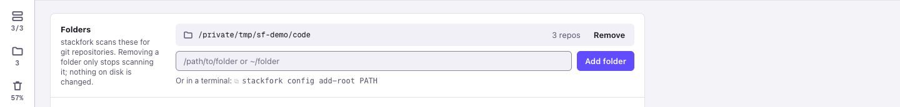
</picture>

2. **Haz clic en "Set up" y elige tu agente.** Tu agente lee el proyecto y guarda cómo arranca. Esto pasa una sola vez, para ti, tu equipo y todos los agentes. También puedes pedírselo a tu agente: "aprende este proyecto con stackfork". Más en [learning.md](references/learning.md).

<picture>
  <source media="(prefers-color-scheme: dark)" srcset="docs/screenshots/learn-with-agent-dark.png">
  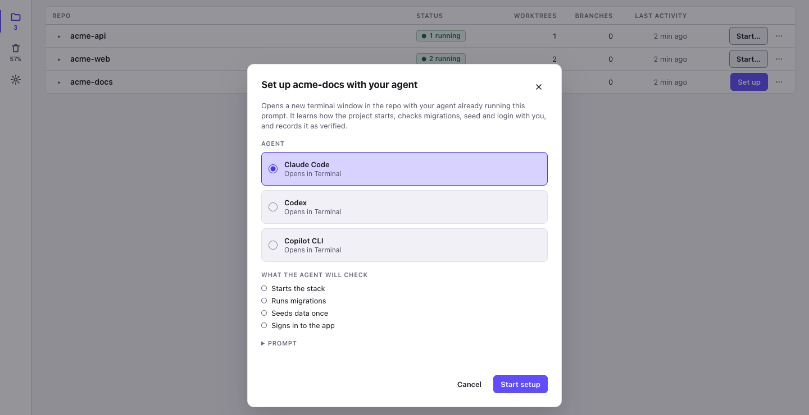
</picture>

3. **Pídele un entorno a tu agente.** Por ejemplo: "crea un entorno de stackfork para la función de facturas". Obtienes una copia completa de la app para esa branch. También puedes presionar **Start** en la página Repos.

<picture>
  <source media="(prefers-color-scheme: dark)" srcset="docs/screenshots/repos-dark.png">
  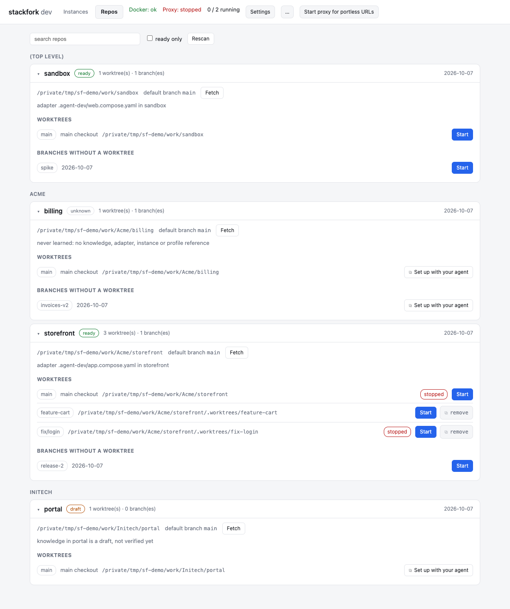
</picture>

4. **Ábrelo.** Cada entorno tiene su propia dirección. Ábrela en el navegador y compárala lado a lado con `main`.

<picture>
  <source media="(prefers-color-scheme: dark)" srcset="docs/screenshots/instances-two-checkouts-dark.png">
  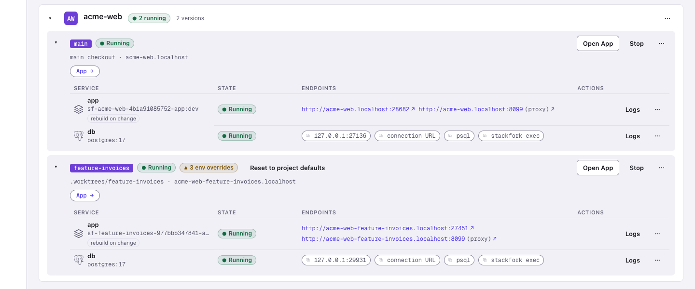
</picture>

<details>
<summary>¿Prefieres la terminal?</summary>

Toda acción también existe como comando. Mira el recorrido completo en [examples/node-postgres](examples/node-postgres/README.md) y todos los comandos en [references/commands.md](references/commands.md).

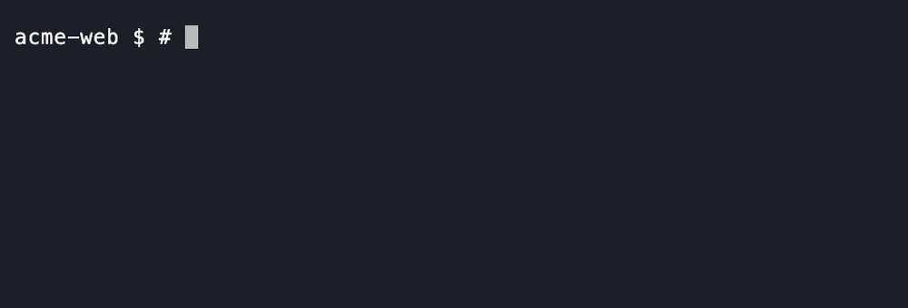

</details>

## Cómo funciona

- **Una receta por proyecto.** Lo que aprendió tu agente queda en un archivo del repositorio. Dice cómo arranca el proyecto, así nadie tiene que recordar los pasos.
- **Una copia por branch.** stackfork arranca el mismo proyecto otra vez para cada branch, con puertos distintos, una base de datos separada y una red separada. Lee tu archivo Docker Compose y nunca lo edita.
- **Una dirección por copia.** Un pequeño proxy local le da a cada copia un nombre que termina en `.localhost`, así abres una URL legible y no un número de puerto.
- **Git decide qué corre.** Una branch recibe un entorno, y un pull request con merge o cerrado se lo quita. stackfork vigila cada proceso que inició y lo recupera después de un reinicio.
- **Las personas tienen las llaves.** Los agentes pueden iniciar, probar y detener entornos. Borrar datos y confiar en comandos nuevos en tu máquina esperan a una persona.

## Qué obtienes

- **Sigue tus pull requests.** Activa el modo live en un repositorio: una nueva branch arranca su entorno sola, cada push lo actualiza y, cuando el pull request tiene merge o se cierra, el entorno se elimina. Solo una persona puede activarlo. [live](references/commands.md#live)
- **Docker, o tu máquina.** Deja la base de datos en Docker y corre la app en tu máquina para tener hot reload y debugger. [host](references/commands.md#host)
- **Vuelve después de reiniciar.** Después de un reboot o de reiniciar Docker, lo que corría arranca de nuevo, sin borrar ni volver a poblar la base de datos.
- **Un ajuste para una branch.** Cambia una variable de entorno en un solo entorno sin tocar el repositorio. [env](references/commands.md#env)
- **Los secrets se quedan en tu llavero.** Las contraseñas y los tokens vienen del llavero del sistema o de 1Password. stackfork nunca los imprime. [secret](references/commands.md#secret)
- **Explica los fallos.** Cada arranque se registra paso a paso con sus logs, para que tú y tu agente vean qué se rompió. [worktrees.md](references/worktrees.md)
- **Dice que no cuando no es seguro.** Si un proyecto no se puede aislar con seguridad, stackfork se niega y te dice qué línea cambiar. [adapting-compose.md](references/adapting-compose.md)

Más screenshots en [docs/screenshots](docs/screenshots). Todos los comandos y flags: [references/commands.md](references/commands.md) o `stackfork help`.

## Trabaja con agentes de código

El repositorio incluye una skill de agente (`SKILL.md` y `references/`) que enseña el flujo: reutilizar lo aprendido, preparar, iniciar, verificar, detener. Enlaza un clon en el directorio de skills de tu agente:

```sh
mkdir -p ~/.claude/skills && ln -s "$(pwd)" ~/.claude/skills/stackfork   # Claude Code
mkdir -p ~/.codex/skills  && ln -s "$(pwd)" ~/.codex/skills/stackfork    # Codex
```

Luego pídeselo al agente con tus propias palabras: "prepara este proyecto en un worktree nuevo y prueba la página de login". Codex necesita que se nombre la skill: `Usa $stackfork para preparar este checkout con un entorno de desarrollo aislado.`

Instala los guard hooks para que un agente no pueda iniciar un servidor de desarrollo en el host, correr un `docker compose up` directo en un checkout gestionado ni borrar datos:

```sh
stackfork hooks install      # --tool claude|codex|copilot to choose one
stackfork hooks status
```

## Seguridad

stackfork aísla los checkouts entre sí. No es un sandbox: no te protege de un archivo Compose malicioso y no agrega nada al aislamiento que Docker ya da entre los contenedores y el host.

- Los guard hooks impiden que los agentes ejecuten `down --volumes`, `reset`, `prune --yes`, `plan --trust`, `live on` y los comandos `secret`. Es una protección para agentes cooperativos, no una barrera de seguridad.
- Los comandos del host solo corren después de que una persona confía en el plan exacto, por máquina. El dashboard solo ejecuta un comando que borra datos después de que una persona confirma en un diálogo nativo.
- `down` conserva los volúmenes. `prune` es una simulación hasta que recibe `--yes`, toca solo objetos con label de stackfork y nunca corre `docker system prune`.
- Los valores de los secrets vienen de tu almacén de credenciales, se muestran como placeholders en el dashboard y en los logs, y `env set` los rechaza.

[SECURITY.md](SECURITY.md) tiene el límite completo, las restricciones conocidas y cómo reportar una vulnerabilidad.

## Por qué no simplemente...

| En lugar de stackfork | Qué hace distinto stackfork |
|---|---|
| `docker compose -p BRANCH` a mano | Deriva el nombre del proyecto, los puertos, los volúmenes y los nombres de contenedor a partir del checkout, agrega una URL `.localhost` y además corre install, migrate, seed, apps del host y limpieza. |
| devcontainers | Lee tu archivo Compose tal como está. Apunta a las colisiones entre copias paralelas, no a un único entorno reproducible. |
| Dagger, container-use | Otra capa: corre tu stack existente, no construye ni aísla en un sandbox por ti. |
| Gestores de worktrees (Conductor y similares) | Los complementa. Ellos crean los worktrees; stackfork hace seguro correr el stack de cada uno, y recuerda cómo. |
| Dokploy, Coolify | Sirven a producción. stackfork sirve a la laptop: muchas copias de un proyecto, para personas y agentes. |

## FAQ

**¿Necesito saber Docker?**
Necesitas Docker corriendo y un proyecto que ya arranque con Docker Compose. Tu agente aprende el resto una vez, y después un entorno nuevo es una petición o un clic.

**¿Cambia mi proyecto?**
Agrega una carpeta, `.stackfork/`, con la receta. Nunca edita tu archivo Compose. Si un proyecto no se puede aislar con seguridad, stackfork se niega y te dice qué línea cambiar.

**¿Con qué agentes de IA funciona?**
Claude Code y Codex tienen una skill lista. Claude Code, Codex y Copilot CLI tienen guard hooks. Cualquier agente que pueda ejecutar un comando de terminal puede usar la CLI.

**¿Cuántas copias puedo correr a la vez?**
Tantas como aguante la memoria de tu computadora. Cada copia es un conjunto completo de contenedores, así que una app pesada cuesta más por branch. El dashboard muestra la memoria y la CPU de cada copia.

**¿Es un sandbox?**
No. stackfork mantiene tus copias separadas entre sí, así que dos branches nunca comparten un puerto ni una base de datos. No es una barrera de seguridad contra código no confiable. Lee el [modelo de seguridad](#seguridad) y [SECURITY.md](SECURITY.md).

**¿Sale algo de mi máquina?**
No hay telemetría ni cuenta. El dashboard escucha solo en `127.0.0.1`. stackfork solo llega a la red a través de tu propio `git` y `gh`, cuando el modo live revisa una branch o un pull request.

## Roadmap

Lo que viene después. Las ideas y los votos son bienvenidos en [Discussions](https://github.com/pedropinheiro75/stackfork/discussions).

- **Compartir un entorno por internet**: dale a alguien un enlace a una branch corriendo en tu laptop, detrás de una capa de autenticación, para que nunca quede abierta a todos.
- **Traefik como proxy**: reemplazar el proxy integrado.
- **Pruebas de carga**: apunta una herramienta de pruebas de carga a cualquier entorno.
- **Alertas de anomalías**: un aviso cuando la CPU o la memoria de una app se comporte de forma anormal.
- **Más stacks listos**: recetas listas para más lenguajes y frameworks, en Docker con hot reload. JavaScript y TypeScript van primero.
- **Una base de datos por branch, de verdad**: copia los datos de `main` a un entorno nuevo, toma un snapshot antes de una migration y restáuralo con un clic.
- **Servidor MCP**: cualquier agente encuentra iniciar, logs, URLs y estado como herramientas, sin una skill que instalar.
- **Dormir lo que está inactivo**: detén un entorno que nadie abrió en un rato y despiértalo con la siguiente petición.
- **Notificaciones**: un mensaje en tu sistema o en Slack cuando un entorno esté listo, falle o se elimine.
- **HTTPS local**: un certificado de confianza para `*.localhost`, para probar cookies seguras, OAuth y service workers.
- **Abrir el pull request de un compañero**: pega la URL del pull request y obtén su entorno corriendo, listo para revisar.
- **Máquina remota**: corre los entornos en un servidor de desarrollo por SSH y abre las URLs en tu laptop.
- **Otros runtimes de contenedores**: soporte probado y documentado para OrbStack, Colima y Podman.
- **Elegir repositorios a mano**: agrega un solo repositorio, o esconde los que no usas.

## Documentación

[references/](references/) · [SKILL.md](SKILL.md) · [SECURITY.md](SECURITY.md) · [CHANGELOG.md](CHANGELOG.md) · [CONTRIBUTING.md](CONTRIBUTING.md) · [LICENSE](LICENSE) (MIT)

**Dale a cada branch, y a cada agente, su propio lugar para correr.** Si stackfork te ahorró una tarde de "port already in use", dale una estrella al repositorio y cuéntaselo a la próxima persona que corra dos agentes en una laptop.
