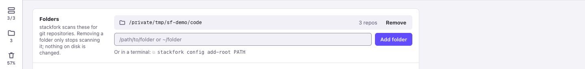
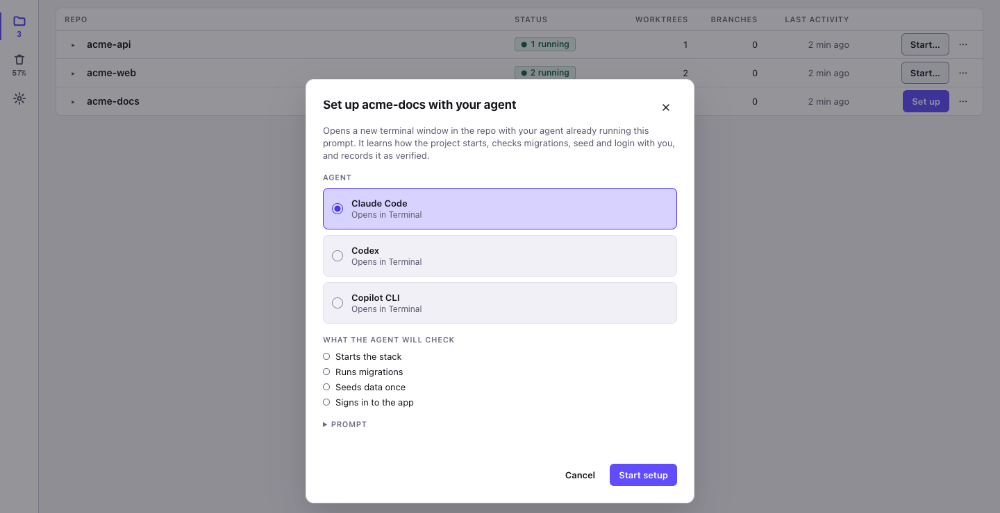
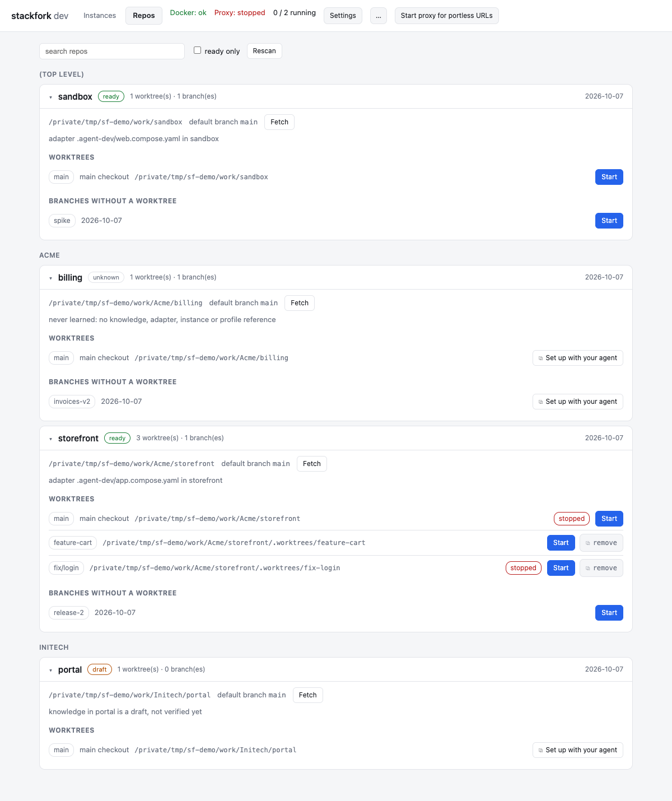
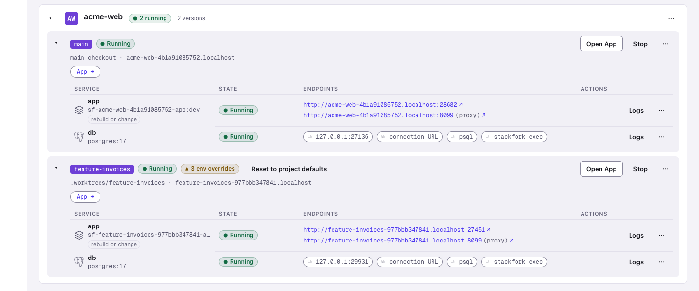

<div align="center">


# stackfork

### Your branches. Your laptop. All running at once.

**A reproducible recipe for running your apps locally, in Docker or on the host. Run as many branches of each as you need, at the same time, with every process supervised and Git opening and closing the environments.**

*Run every app you build with AI, in as many versions as you like, all at once on your own computer, with none of them getting in each other's way.*

[](https://github.com/pedropinheiro75/stackfork/actions/workflows/ci.yml)


[](LICENSE)

[Install](#install) · [Quick start](#quick-start) · [How you use it](#how-you-use-it) · [How it works](#how-it-works) · [Agents](#work-with-coding-agents) · [Safety](#safety) · [FAQ](#faq) · [Roadmap](#roadmap) · [Docs](#docs)

</div>


**The problem.** You hand an AI agent a branch and keep working on another. Both run `docker compose up`. Same ports, same container names, same volumes, often the same database. One of you breaks the other, and the agent cannot tell.

**The fix.** stackfork learns how your project starts, once, and records the recipe in the repository: what runs in Docker, what runs on the host, what to install, migrate and seed, and which URL to open. From then on every worktree starts with one command, on its own ports, volumes, network and `.localhost` URL. Five agents and you can work on five branches of one project on one laptop, and nothing collides.

<picture>
  <source media="(prefers-color-scheme: dark)" srcset="docs/screenshots/instances-overview-dark.png">
  
</picture>

*The dashboard: two projects, three running copies. `acme-api` runs its app on the host with hot reload and its database in Docker. `acme-web` runs `main` and `feature-invoices` side by side, each with its own URL, database port and env overrides.*

## Why developers keep it

| | |
|---|---|
| **Nothing new to maintain** | It reads the Compose file you already maintain and never edits it. If something cannot be isolated safely, it names the line. |
| **Hot reload and a debugger, still isolated** | Keep Postgres and Redis in containers and run the app on the host for hot reload and a debugger. Each branch still gets its own copy. |
| **Environments that follow your pull requests** | `worktree add` + `start-env`, or turn on live mode and a new branch starts by itself. Merge or close the pull request, and the environment goes away. GitOps, on your laptop. |
| **Set up once, for the whole team** | The startup plan is a committed file. Teammates and agents start the project the same way, every time. |
| **Agents run free, people hold the keys** | Agents start, test and stop environments on their own. Deleting data, trusting host commands and turning automation on wait for a person. |
| **Still running after a restart** | Host apps are health-checked and restarted. After a reboot, what was running comes back, and what lost its database stops instead of running against nothing. |
| **Every copy in one place** | A dashboard and a macOS menu bar app show every running copy, its URLs, memory and CPU, and why a start failed. |


## Install

macOS and Linux, amd64 and arm64. Docker with the Compose plugin must be running. Pick one:

- Homebrew (macOS and Linux): `brew trust pedropinheiro75/tap && brew install --cask pedropinheiro75/tap/stackfork`
- Shell script: `curl -fsSL https://raw.githubusercontent.com/pedropinheiro75/stackfork/main/install.sh | sh`
- Binaries: download one from the [Releases page](https://github.com/pedropinheiro75/stackfork/releases).
- Go 1.26.10 or later: `go install github.com/pedropinheiro75/stackfork/cmd/stackfork@latest`

To build from a clone, run `go build -o stackfork ./cmd/stackfork` and put the binary on your `PATH`. Check the install with `stackfork version`. The macOS menu bar app is the `.dmg` on the Releases page: see [docs/macos-app.md](docs/macos-app.md).

## Quick start

Two isolated copies of `examples/node-postgres`, a small Node server with Postgres that counts visits:

```sh
git clone https://github.com/pedropinheiro75/stackfork && cd stackfork
stackfork learn && stackfork prepare -f examples/node-postgres/docker-compose.yml && stackfork up
git worktree add ../stackfork-2 && cd ../stackfork-2
stackfork prepare -f examples/node-postgres/docker-compose.yml && stackfork up
stackfork list && stackfork urls
```

`stackfork list` shows two running instances. `stackfork urls` prints a `.localhost` URL per checkout. Request each URL more than once: the `visits` count of one copy does not change the other. If the URLs do not answer, run `stackfork proxy up`. Clean up with `stackfork down --volumes` in each checkout.

For your own project, the recommended way is to let your AI agent run the learn session: ask it to "learn this project with stackfork", or click **Set up** on the project in the dashboard. The scan drafts the recipe, the agent fills in what a scan cannot know (which script is the dev server, what seeds the database, which URL to open) and confirms it with `learn verify`. From then on every worktree starts with `stackfork start-env`.

## How you use it

1. **Point stackfork at your code folder.** Run `stackfork dashboard --open`. In **Settings**, add the folder that holds all your projects, for example `~/code`.

<picture>
  <source media="(prefers-color-scheme: dark)" srcset="docs/screenshots/settings-folders-dark.png">
  
</picture>

2. **Click "Set up" and pick your agent.** Your agent reads the project and saves how it starts. This happens once, for you, your team and every agent. More in [learning.md](references/learning.md).

<picture>
  <source media="(prefers-color-scheme: dark)" srcset="docs/screenshots/learn-with-agent-dark.png">
  
</picture>

The result is a workflow you can read:

<picture>
  <source media="(prefers-color-scheme: dark)" srcset="docs/screenshots/project-workflow-dark.png">
  
</picture>

3. **Ask your agent for an environment.** For example: "create a stackfork environment for the invoices feature". You get a full copy of the app for that branch. You can also press **Start** on the Repos page.

<picture>
  <source media="(prefers-color-scheme: dark)" srcset="docs/screenshots/repos-dark.png">
  
</picture>

4. **Open it.** Each environment has its own address. Open it in the browser and compare it side by side with `main`.

<picture>
  <source media="(prefers-color-scheme: dark)" srcset="docs/screenshots/instances-two-checkouts-dark.png">
  
</picture>

## How it works

- **One recipe per project.** What your agent learned is a file in the repository. It says how the project starts, so nobody has to remember the steps.
- **One copy per branch.** stackfork starts the same project again for each branch, with different ports, a separate database and a separate network. It reads your Docker Compose file and never edits it.
- **One address per copy.** A small local proxy gives each copy a name ending in `.localhost`, so you open a readable URL and not a port number.
- **Git decides what runs.** A branch gets an environment, and a merged or closed pull request takes it away. stackfork watches every process it started and brings it back after a restart.
- **People keep the keys.** Agents can start, test and stop environments. Deleting data and trusting new commands on your machine wait for a person.

## What you get

- **Follows your pull requests.** Turn on live mode for a repository: a new branch starts its environment by itself, each push updates it, and when the pull request is merged or closed the environment is removed. Only a person can turn this on. [live](references/commands.md#live)
- **Docker, or your machine.** Keep the database in Docker and run the app on your machine for hot reload and a debugger. [host](references/commands.md#host)
- **Comes back after a restart.** After a reboot or a Docker restart, what was running starts again, without wiping or re-filling the database.
- **One setting for one branch.** Change an environment variable for a single environment without touching the repository. [env](references/commands.md#env)
- **Secrets stay in your keychain.** Passwords and tokens come from the OS keychain or 1Password. stackfork never prints them. [secret](references/commands.md#secret)
- **Explains failures.** Every start is recorded step by step with its logs, so you and your agent can see what broke. [worktrees.md](references/worktrees.md)
- **Says no when it is not safe.** If a project cannot be isolated safely, stackfork refuses and tells you which line to change. [adapting-compose.md](references/adapting-compose.md)

More screenshots in [docs/screenshots](docs/screenshots). Every command and flag: [references/commands.md](references/commands.md) or `stackfork help`.

## Work with coding agents

The repository ships an agent skill (`SKILL.md` and `references/`) that teaches the flow: reuse what was learned, prepare, start, verify, stop. Link a clone into your agent's skill directory:

```sh
mkdir -p ~/.claude/skills && ln -s "$(pwd)" ~/.claude/skills/stackfork   # Claude Code
mkdir -p ~/.codex/skills  && ln -s "$(pwd)" ~/.codex/skills/stackfork    # Codex
```

Then ask the agent in your own words: "prepare this project in a new worktree and test the login page". Codex needs the skill named: `Use $stackfork to prepare this checkout with an isolated development environment.`

Install the guard hooks so an agent cannot start a dev server on the host, run a raw `docker compose up` in a managed checkout, or delete data:

```sh
stackfork hooks install      # --tool claude|codex|copilot to choose one
stackfork hooks status
```

## Safety

stackfork isolates checkouts from each other. It is not a sandbox: it does not protect you from a malicious Compose file, and it adds nothing to the isolation Docker gives between containers and the host.

- The guard hooks block agents from `down --volumes`, `reset`, `prune --yes`, `plan --trust`, `live on` and the `secret` commands. It is a guardrail for cooperative agents, not a security boundary.
- Host commands run only after a person trusts the exact plan, per machine. The dashboard runs a data-deleting command only after a person confirms in a native dialog.
- `down` keeps volumes. `prune` is a dry run until `--yes`, touches only stackfork-labelled objects, and never runs `docker system prune`.
- Secret values come from your credential store, show as placeholders in the dashboard and logs, and are refused by `env set`.

[SECURITY.md](SECURITY.md) has the full boundary, the known limits and how to report a vulnerability.

## Why not just...

| Instead of stackfork | What stackfork does differently |
|---|---|
| `docker compose -p BRANCH` by hand | Derives the project name, ports, volumes and container names from the checkout, adds a `.localhost` URL, and also runs install, migrate, seed, host apps and cleanup. |
| devcontainers | Reads your Compose file as it is. It targets collisions between parallel copies, not one reproducible environment. |
| Dagger, container-use | A different layer: runs your existing stack, does not build or sandbox for you. |
| Worktree managers (Conductor and the like) | Complements them. They create the worktrees; stackfork makes each one's stack safe to run, and remembers how. |
| Dokploy, Coolify | They serve production. stackfork serves the laptop: many copies of one project, for people and agents. |

## FAQ

**Do I need to know Docker?**
You need Docker running and a project that already starts with Docker Compose. Your agent learns the rest once, and after that a new environment is one request or one click.

**Does it change my project?**
It adds one folder, `.stackfork/`, with the recipe. It never edits your Compose file. If a project cannot be isolated safely, stackfork refuses and names the line to change.

**Which AI agents does it work with?**
Claude Code and Codex have a ready skill. Claude Code, Codex and Copilot CLI have guard hooks. Any agent that can run a terminal command can use the CLI.

**How many copies can I run at once?**
As many as your computer's memory allows. Each copy is a full set of containers, so a heavy app costs more per branch. The dashboard shows memory and CPU per copy.

**Is it a sandbox?**
No. stackfork keeps your copies apart from each other, so two branches never share a port or a database. It is not a security boundary against untrusted code. Read the [safety model](#safety) and [SECURITY.md](SECURITY.md).

**Does anything leave my machine?**
There is no telemetry and no account. The dashboard listens only on `127.0.0.1`. stackfork reaches the network only through your own `git` and `gh` when live mode checks a branch or a pull request.

## Roadmap

What is planned next. Ideas and votes are welcome in [Discussions](https://github.com/pedropinheiro75/stackfork/discussions).

- **Native Windows support**: in progress.
- **Share an environment over the internet**: give someone a link to one running branch on your laptop, behind an authentication layer so it is never open to everyone.
- **Traefik as the proxy**: replace the built-in proxy.
- **Load testing**: point a load-testing tool at any environment.
- **Anomaly alerts**: a warning when an app's CPU or memory behaves abnormally.
- **More stacks out of the box**: ready recipes for more languages and frameworks, in Docker with hot reload. JavaScript and TypeScript come first.
- **A database per branch, for real**: copy the data of `main` into a new environment, take a snapshot before a migration, and restore it with one click.
- **MCP server**: any agent finds start, logs, URLs and status as tools, with no skill to install.
- **Sleep what is idle**: stop an environment nobody opened for a while, and wake it on the next request.
- **Notifications**: a message on your system or in Slack when an environment is ready, fails or is removed.
- **Local HTTPS**: a trusted certificate for `*.localhost`, to test secure cookies, OAuth and service workers.
- **Open a teammate's pull request**: paste the pull request URL and get its environment running, ready to review.
- **Remote machine**: run the environments on a development server over SSH and open the URLs on your laptop.
- **Other container runtimes**: tested and documented support for OrbStack, Colima and Podman.
- **Pick repositories by hand**: add a single repository, or hide the ones you do not use.

## Docs

[references/](references/) · [SKILL.md](SKILL.md) · [SECURITY.md](SECURITY.md) · [CHANGELOG.md](CHANGELOG.md) · [CONTRIBUTING.md](CONTRIBUTING.md) · [LICENSE](LICENSE) (MIT)

**Give every branch, and every agent, its own place to run.** If stackfork saved you an afternoon of "port already in use", star the repository and tell the next person who runs two agents on one laptop.
