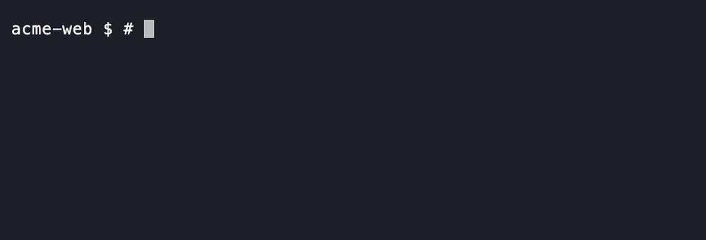
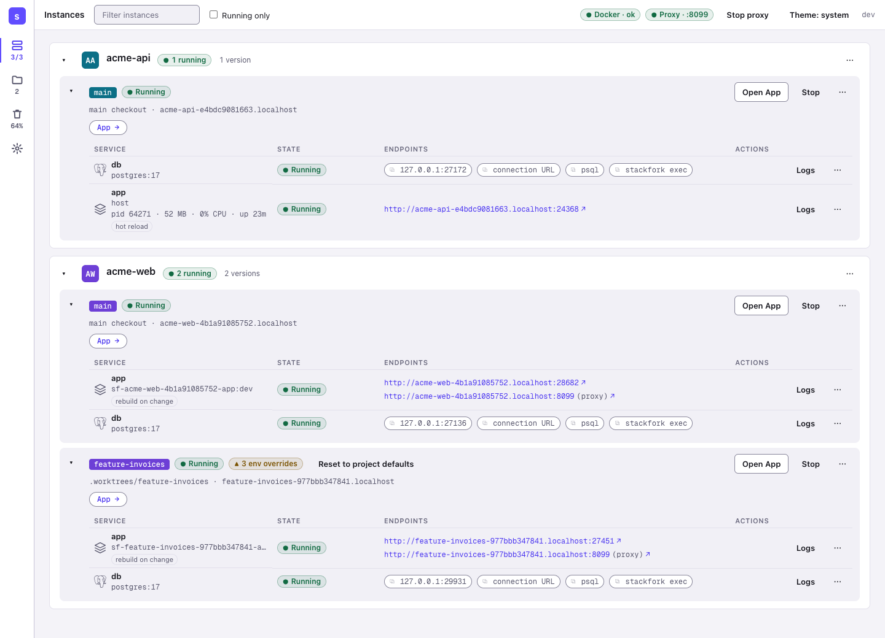
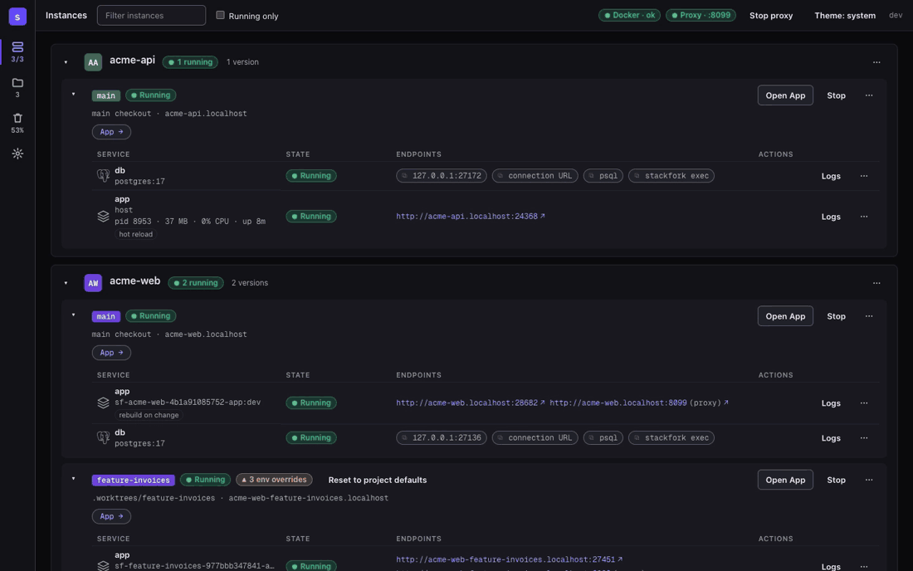
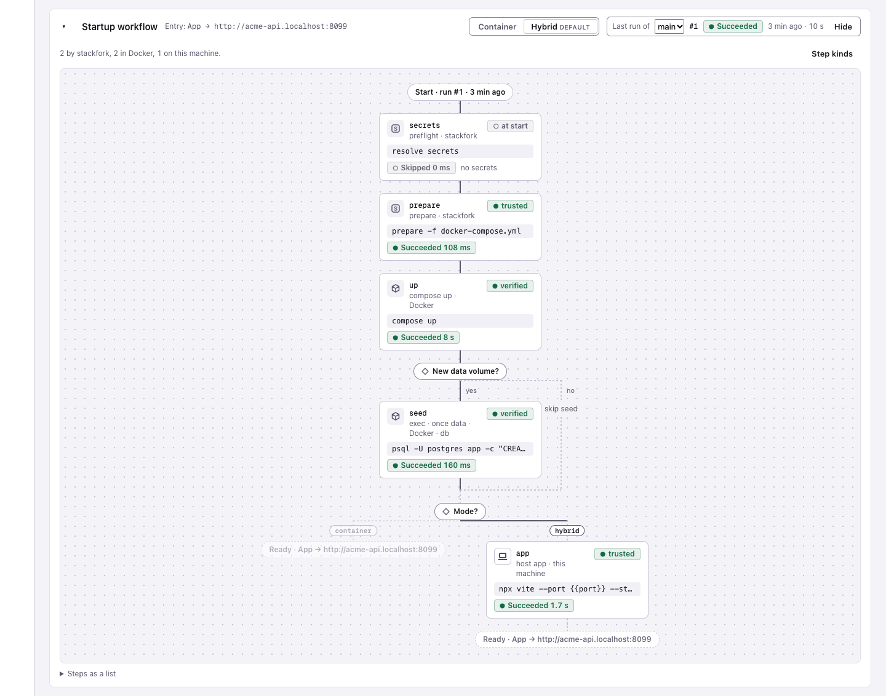

<div align="center">


# stackfork

### Every branch gets its own running stack. Every AI agent gets its own.

**A reproducible recipe for running your apps locally, in Docker or on the host. Run as many branches of each as you need, at the same time, with every process supervised and Git opening and closing the environments.**

*Run every app you build with AI, in as many versions as you like, all at once on your own computer, with none of them getting in each other's way.*

[](https://github.com/pedropinheiro75/stackfork/actions/workflows/ci.yml)


[](LICENSE)

[Install](#install) · [Quick start](#quick-start) · [How it works](#how-it-works) · [Agents](#work-with-coding-agents) · [Safety](#safety) · [Docs](#docs)

</div>



**The problem.** You hand an AI agent a branch and keep working on another. Both run `docker compose up`. Same ports, same container names, same volumes, often the same database. One of you breaks the other, and the agent cannot tell.

**The fix.** stackfork learns how your project starts, once, and records the recipe in the repository: what runs in Docker, what runs on the host, what to install, migrate and seed, and which URL to open. From then on every worktree starts with one command, on its own ports, volumes, network and `.localhost` URL. Five agents and you can work on five branches of one project on one laptop, and nothing collides.

<picture>
  <source media="(prefers-color-scheme: dark)" srcset="docs/screenshots/instances-overview-dark.png">
  
</picture>

*The dashboard: two projects, three running copies. `acme-api` runs its app on the host with hot reload and its database in Docker. `acme-web` runs `main` and `feature-invoices` side by side, each with its own URL, database port and env overrides.*

## Why developers keep it

| | |
|---|---|
| **Zero new config** | It reads the Compose file you already maintain and never edits it. If something cannot be isolated safely, it names the line. |
| **Docker, or not** | Keep Postgres and Redis in containers and run the app on the host for hot reload and a debugger. Each branch still gets its own copy. |
| **Git drives it** | `worktree add` + `start-env`, or turn on live mode and a new branch starts by itself. Merge or close the pull request, and the environment goes away. GitOps, on your laptop. |
| **Learn once, start forever** | The startup plan is a committed file. Teammates and agents start the project the same way, every time. |
| **Agents run free, people hold the keys** | Agents start, test and stop environments on their own. Deleting data, trusting host commands and turning automation on wait for a person. |
| **Every process is supervised** | Host apps are health-checked and restarted. After a reboot, what was running comes back, and what lost its database stops instead of running against nothing. |
| **You see everything** | A dashboard and a macOS menu bar app show every running copy, its URLs, memory and CPU, and why a start failed. |



## Install

macOS and Linux, amd64 and arm64. Docker with the Compose plugin must be running.

```sh
go install github.com/pedropinheiro75/stackfork/cmd/stackfork@latest   # Go 1.26.10 or later
```

Or build from a clone with `go build -o stackfork ./cmd/stackfork`. Put the binary on your `PATH` and check it with `stackfork version`. The macOS menu bar app is built from the same clone: see [docs/macos-app.md](docs/macos-app.md).

## Quick start

Two isolated copies of `examples/node-postgres`, a small Node server with Postgres that counts visits:

```sh
git clone https://github.com/pedropinheiro75/stackfork && cd stackfork
stackfork learn && stackfork prepare -f examples/node-postgres/docker-compose.yml && stackfork up
git worktree add ../stackfork-2 && cd ../stackfork-2
stackfork prepare -f examples/node-postgres/docker-compose.yml && stackfork up
stackfork list && stackfork urls
```

`stackfork list` shows two running instances. `stackfork urls` prints a `.localhost` URL per checkout. Request each URL more than once: the `visits` count of one copy does not change the other. If the URLs do not answer, run `stackfork proxy up`. Clean up with `stackfork down --volumes` in each checkout.

For your own project, the recommended way is to let your AI agent run the learn session: ask it to "learn this project with stackfork", or click **Learn with your agent** in the dashboard. The scan drafts the recipe, the agent fills in what a scan cannot know (which script is the dev server, what seeds the database, which URL to open) and confirms it with `learn verify`. From then on every worktree starts with `stackfork start-env`.

## How it works

- **Isolate.** Each checkout gets its own project name, ports, volumes, network and container names, plus a stable `.localhost` hostname through a shared proxy. A stack that cannot be isolated safely (fixed container names, external networks, the Docker socket, writable binds outside the checkout) is refused with the line to change. [adapting-compose.md](references/adapting-compose.md)
- **Learn.** `stackfork learn` scans Compose files, Dockerfiles, entrypoints and scripts, offline, and drafts `.stackfork/knowledge.json`: the ordered startup plan (install, build, migrate, seed, host apps), the entry URL, the secrets by name, and how code changes reach each app. Your agent fills in what the scan cannot know and confirms it with `learn verify`. The file is safe to commit. [learning.md](references/learning.md)
- **Start.** `stackfork worktree add REPO BRANCH` then `stackfork start-env`. Every start is a recorded run with its steps and logs, secrets redacted; `stackfork runs show` explains a failure. `stackfork reset` throws the environment away and starts again. [worktrees.md](references/worktrees.md)
- **Hybrid mode.** A `host` step runs the app on the host with the instance's environment (`DATABASE_URL`, `REDIS_URL`, `<SERVICE>_URL`) and a `.localhost` route, while dependencies stay in Docker. A host command runs only after a person trusts the exact plan. [host](references/commands.md#host)
- **Local GitOps.** With `stackfork live on`, every start syncs the branch and the dashboard rebuilds what changed on each push. A merged or closed pull request removes the worktree, the instance and its volumes, after a grace period or automatically. Only a person turns this on. [live](references/commands.md#live)
- **Supervise.** After a reboot or a Docker restart, the dashboard resumes what you had running, without re-seeding. With a stop cascade, losing a database also stops the apps that need it.
- **Configure one instance.** `stackfork env set SERVICE NAME=VALUE` changes one variable of one instance. Secrets are mapped per machine to the OS keychain or a 1Password `op://` reference, and no command prints a value. [env](references/commands.md#env) · [secret](references/commands.md#secret)
- **Dashboard.** `stackfork dashboard --open` serves a page on `127.0.0.1` with every instance, repository and worktree, the startup workflow as a canvas, resource charts, overrides and the last run of each checkout. The macOS app runs the same page.

<picture>
  <source media="(prefers-color-scheme: dark)" srcset="docs/screenshots/project-workflow-dark.png">
  
</picture>

*The Project page: the startup plan of a hybrid project as a canvas, each step with the state of its last run.*

More screenshots in [docs/screenshots](docs/screenshots). Every command and flag: [references/commands.md](references/commands.md) or `stackfork help`.

## Work with coding agents

The repository ships an agent skill (`SKILL.md` and `references/`) that teaches the flow: reuse what was learned, prepare, start, verify, stop. Link a clone into your agent's skill directory:

```sh
mkdir -p ~/.claude/skills && ln -s "$(pwd)" ~/.claude/skills/stackfork   # Claude Code
mkdir -p ~/.codex/skills  && ln -s "$(pwd)" ~/.codex/skills/stackfork    # Codex
```

Then ask the agent in your own words: "prepare this project in a new worktree and test the login page". Codex needs the skill named: `Use $stackfork to prepare this checkout with an isolated development environment.`

Install the guard hooks so an agent cannot start a dev server on the host, run a raw `docker compose up` in a managed checkout, or delete data:

```sh
stackfork hooks install      # --tool claude|codex|copilot to choose one
stackfork hooks status
```

## Safety

stackfork isolates checkouts from each other. It is not a sandbox: it does not protect you from a malicious Compose file, and it adds nothing to the isolation Docker gives between containers and the host.

- The guard hooks block agents from `down --volumes`, `reset`, `prune --yes`, `plan --trust`, `live on` and the `secret` commands. It is a guardrail for cooperative agents, not a security boundary.
- Host commands run only after a person trusts the exact plan, per machine. The dashboard runs a data-deleting command only after a person confirms in a native dialog.
- `down` keeps volumes. `prune` is a dry run until `--yes`, touches only stackfork-labelled objects, and never runs `docker system prune`.
- Secret values come from your credential store, show as placeholders in the dashboard and logs, and are refused by `env set`.

[SECURITY.md](SECURITY.md) has the full boundary, the known limits and how to report a vulnerability.

## Why not just...

| Instead of stackfork | What stackfork does differently |
|---|---|
| `docker compose -p BRANCH` by hand | Derives the project name, ports, volumes and container names from the checkout, adds a `.localhost` URL, and also runs install, migrate, seed, host apps and cleanup. |
| devcontainers | Reads your Compose file as it is. It targets collisions between parallel copies, not one reproducible environment. |
| Dagger, container-use | A different layer: runs your existing stack, does not build or sandbox for you. |
| Worktree managers (Conductor and the like) | Complements them. They create the worktrees; stackfork makes each one's stack safe to run, and remembers how. |
| Dokploy, Coolify | They serve production. stackfork serves the laptop: many copies of one project, for people and agents. |

## Docs

[references/](references/) · [SKILL.md](SKILL.md) · [SECURITY.md](SECURITY.md) · [CHANGELOG.md](CHANGELOG.md) · [CONTRIBUTING.md](CONTRIBUTING.md) · [LICENSE](LICENSE) (MIT)

If stackfork saved you an afternoon of "port already in use", star the repository and tell the next person who runs two agents on one laptop.
