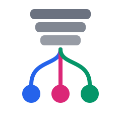
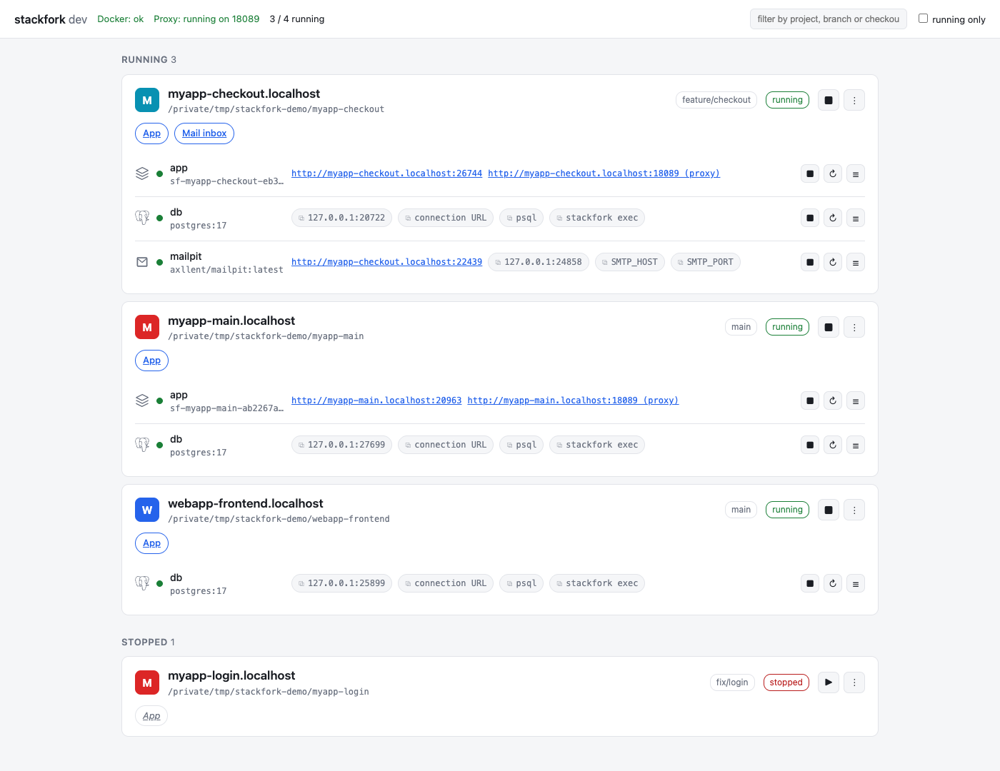
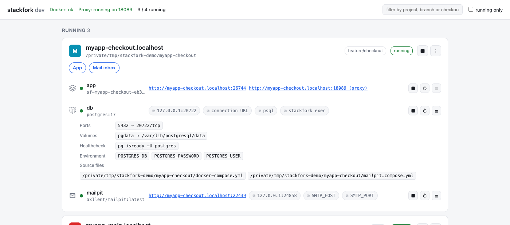

<div align="center">



# stackfork

**Run the same project twice — for two AI agents, or an agent and you — without them stepping on each other.** 🧑‍🤝‍🧑🤖

[](https://github.com/pedropinheiro75/stackfork/actions/workflows/ci.yml)
[](https://pkg.go.dev/github.com/pedropinheiro75/stackfork)


[](LICENSE)

</div>

The moment you (or a coding agent) open a second Git worktree of a project and run `docker compose up`, it collides with the first: same ports, same container names, same volumes, sometimes the same database. Today the fix is manual — hand-edit `.env`, guess free ports, remember which worktree owns which container — and it breaks the moment a teammate's agent does the same thing next to yours.

**stackfork takes the Compose stack you already have and isolates it per checkout-and-branch** — its own ports, volumes, network, container names — so a human and an agent, or five agents, can each have a fully running copy of the same project at the same time, on the same machine, without coordinating.

<!-- TODO: 20s demo GIF (openspec/changes/prepare-open-source-release task 12.2) -->

## 🚀 Install

```sh
go install github.com/pedropinheiro75/stackfork/cmd/stackfork@latest
```

Make sure `stackfork` resolves on `PATH` (typically `$(go env GOPATH)/bin`, often `~/go/bin`).

From a local checkout instead:

```sh
go install ./cmd/stackfork
```

## ⚡ Quick start

Five commands, on a project you already have checked out with a Compose file:

```sh
git worktree add ../myproject-feature feature-branch   # a second copy of the same repo
cd ../myproject-feature
stackfork prepare                                       # isolate this checkout+branch's copy of the stack
stackfork up                                             # start it
stackfork urls                                           # e.g. myproject-feature-a1b2c3.localhost:54211
```

Run `stackfork list` from either checkout to see both instances — and your original checkout's stack, still running untouched on its own ports. No `.env` surgery, no port bookkeeping, no `docker compose down` in the other window first.

`prepare` reuses the same source-file selection on later runs. It renders your project's actual `docker-compose.yml` (or whichever files you pass with `-f`) into an isolated snapshot: fresh container/volume/network names keyed on checkout path + branch, ports reassigned off Docker's collision, secrets never printed or stored. Nothing about your Compose file itself changes.

**No Compose file yet?** `assets/nuxt/` and `assets/go/` are optional starting-point stacks (app + Postgres, no host installs needed) for a Nuxt or a Go web app with nothing to adapt — see `references/nuxt-template.md` / `references/go-template.md`. Everything else (any other language, any existing Compose setup) goes through the isolation flow above directly; the templates are a bootstrap for the one case that has nothing to isolate yet, not a requirement.

### Host-run apps

Only the dependencies need isolating? `stackfork prepare`/`up` your Compose file (database, cache, mail catcher, …), then run the app itself on the host, pointed at the isolated stack with:

```sh
eval "$(stackfork env)"   # DATABASE_URL, REDIS_URL, SMTP_HOST/PORT, <SERVICE>_URL — one per service
npm run dev                # or however this project starts
```

`stackfork route add <name> <port>` gives it a portless `*.localhost` URL through the shared proxy, same as a containerized service. `--with-passwords` fills in a real credential, but only when it's a literal value in your Compose file — never a `--secret`/`env_file` one. Seeding that database from a teammate's dump or a production export instead of an empty one: `stackfork clone-db --from-dump backup.sql` (also takes `.sql.gz` or a Postgres custom-format dump).

## 🆚 How it's different

stackfork isn't a new environment format and it doesn't run your project *for* you — it isolates the Compose stack you already maintain, as-is:

| | stackfork | devcontainers | Dagger / container-use | Conductor-style worktree managers |
|---|---|---|---|---|
| What it reads | Your existing Compose file, unmodified | A new `devcontainer.json`, usually duplicating Compose | A pipeline you write | Whatever you've already set up |
| What it solves | Two copies of the same stack colliding | One reproducible dev environment | Programmable container builds/CI | Orchestrating worktrees & agents |
| Overlaps with stackfork | — | Partial (dev environment, not collision-safe) | Rarely (different layer) | Complements it — stackfork is the missing piece underneath |

## 📊 Dashboard

```sh
stackfork dashboard --open
```

A local, read-mostly web page listing every instance across every checkout it knows about: status, services, health, clickable app/DB/mail endpoints (labelled by role, not just raw ports), learned-knowledge status, plain-language warnings. Local-only (binds `127.0.0.1`, checks the `Host` header, a per-process token guards every action) — the only actions it can take are `up`, `down` (volumes always kept), per-service `restart`/`start`/`stop`, viewing logs, and the shared proxy's up/down/reload. Destructive or input-heavy operations (`down --volumes`, `prepare --reassign-ports`, `learn`) show up as an exact command to copy, never a button. `stackfork list` / `list --json` show the same data from a terminal.

<picture>
  <source media="(prefers-color-scheme: dark)" srcset="docs/screenshots/dashboard-overview-dark.png">
  <source media="(prefers-color-scheme: light)" srcset="docs/screenshots/dashboard-overview-light.png">
  
</picture>

Each service's row expands to the exact command for a destructive action, and connection strings/CLI snippets copy with one click (a real password only ever appears if it's a literal value in your Compose file — see [SECURITY.md](SECURITY.md)):

<picture>
  <source media="(prefers-color-scheme: dark)" srcset="docs/screenshots/dashboard-service-detail-dark.png">
  <source media="(prefers-color-scheme: light)" srcset="docs/screenshots/dashboard-service-detail-light.png">
  
</picture>

## 🔒 Safety model

stackfork's job is **collision isolation between checkouts** — making sure parallel worktrees/branches of the same project don't collide on ports, volumes, networks, container names, databases or cookies, and refusing what it can't isolate safely (fixed container names, external networks, the Docker socket, writable binds outside the checkout, fixed subnets) rather than working around it silently.

It is **not** a sandbox. It doesn't protect against a malicious or untrusted Compose file, doesn't isolate containers from the host beyond what Docker itself provides, and assumes the project you're isolating is one you already trust enough to run its Compose stack directly. See [SECURITY.md](SECURITY.md) for the full boundary, including the one endpoint (`/api/copy`, dashboard) that ever returns a real credential and exactly when.

## 🤖 Agent skill install

The skill this repo ships (`SKILL.md` plus `references/`) teaches an agent the same discover → prepare → up → verify → down flow this README uses, plus how to adapt a project's real Compose stack instead of forcing a template on it. Point your agent's skill directory at this checkout:

```sh
# Claude Code
mkdir -p ~/.claude/skills && ln -s "$(pwd)" ~/.claude/skills/stackfork

# Codex
mkdir -p ~/.codex/skills && ln -s "$(pwd)" ~/.codex/skills/stackfork
```

Then just ask, in your own words, for what you want done — Claude Code matches the skill from `SKILL.md`'s own `description`, e.g. "prepare this project in a new worktree" or "run the app in an isolated dev environment" is enough, no special syntax required (that's how every isolation task in this project's own history got triggered). Codex reads `agents/openai.yaml`'s `default_prompt` instead, so use that exact phrasing there:

```
Use $stackfork to prepare this checkout with an isolated development environment using stackfork.
```

Project- or company-specific recipes (a client's known gotchas, a shared registry token source, a house Nuxt template) stay out of this repo entirely — they live in your own private profile directory (`~/.config/stackfork/profiles/*`, or `$STACKFORK_PROFILE_DIRS`), which `stackfork where` reports back to the agent when one applies.

### Agent guardrails

Agents drift: one that was told to use isolation will still, now and then, run `cd .worktrees/pr630 && bun run dev` straight on the host and collide with everything. stackfork ships a pre-tool-use hook that stops exactly that, and nothing else:

```sh
stackfork hooks install      # Claude Code, Codex and Copilot CLI (--tool to pick one); backs up each file first
stackfork hooks status
```

`stackfork guard` then reads each tool's hook JSON and blocks only a dev server (`bun|npm|pnpm|yarn dev|start|serve`, `nuxt dev`, `vite`, `next dev`, `nodemon`) or a raw `docker compose up/start`, and only inside a stackfork-managed checkout. Tests, builds, lint, `git`, `stackfork` itself and anything outside a managed checkout pass untouched; when it can't tell, it allows. **Codex only runs a hook you have trusted:** after `hooks install --tool codex`, open `codex` once and approve the new hook (or run `/hooks`). stackfork never writes that approval itself; `hooks status` reports `installed but untrusted` until it exists. The sanctioned host-run path is `stackfork host app -- <your command>`: a stable port, this instance's env and a portless route for as long as it runs. It is a guardrail for cooperative agents, not a sandbox.

Two related conveniences: `--instance NAME` (any command) addresses an instance from any directory, and `stackfork open` opens its app URL. If the portless URLs stop answering after a Docker restart, `stackfork proxy up` brings the proxy back (it now restarts with Docker by itself); `status`, `urls`, `doctor` and the dashboard say so when it is down.

## ✅ Checks

```sh
go test ./...
```

Optional live checks create disposable Docker stacks and clean up their own resources:

```sh
STACKFORK_LIVE=1 go test ./...
```

Live tests use synthetic Compose fixtures in `testdata/`, including a synthetic Node streaming app for the template/proxy checks, and may download public images/packages. Neither establishes compatibility with any real application.

State lives under `~/.local/state/stackfork`. Legacy `idv-` Docker identities and their previous state path are still read, so existing stacks are never orphaned.
