<div align="center">

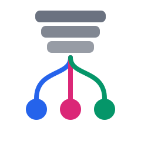

# stackfork

### Suas branches. Seu notebook. Tudo rodando ao mesmo tempo.

Rode cada app que você cria com IA, em quantas versões quiser, todas ao mesmo tempo no seu próprio computador, sem que uma atrapalhe a outra.

[English](README.md) · **Português** · [Español](README.es.md)

[](https://github.com/pedropinheiro75/stackfork/actions/workflows/ci.yml)


[](LICENSE)

[Como fica](#como-fica) · [Instalação](#instalação) · [Como você usa](#como-você-usa) · [Como funciona](#como-funciona) · [Agentes](#use-com-agentes-de-código) · [Segurança](#segurança) · [FAQ](#faq) · [Roadmap](#roadmap) · [Documentação](#documentação)

</div>

> Esta página é uma tradução do [README em inglês](README.md). Se houver diferença, o texto em inglês é o correto.

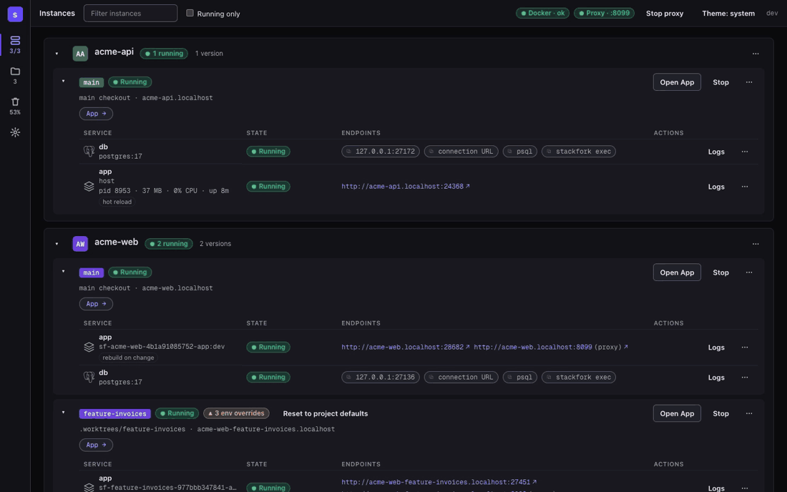

**O problema.** Você entrega uma branch para um agente de IA e continua trabalhando em outra. Os dois rodam `docker compose up`. As mesmas portas, os mesmos nomes de contêiner, os mesmos volumes, muitas vezes o mesmo banco de dados. Um de vocês quebra o outro, e o agente não percebe.

**A solução.** O stackfork aprende uma vez como o seu projeto sobe e grava a receita no repositório: o que roda no Docker, o que roda no host, o que instalar, migrar e popular, e qual URL abrir. Daí em diante, cada worktree sobe com um único comando, com portas, volumes, rede e URL `.localhost` próprios. Cinco agentes e você podem trabalhar em cinco branches do mesmo projeto no mesmo notebook, e nada colide.

## Como fica

<picture>
  <source media="(prefers-color-scheme: dark)" srcset="docs/screenshots/instances-overview-dark.png">
  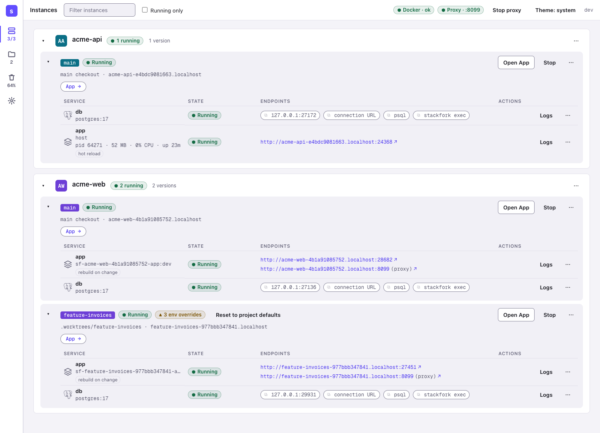
</picture>

**Visão geral.** Dois projetos, três cópias rodando. O `acme-api` roda o app no host com hot reload e o banco no Docker. O `acme-web` roda `main` e `feature-invoices` lado a lado, cada um com sua URL, porta de banco e overrides de env.

<table>
<tr>
<td width="50%">
<picture>
  <source media="(prefers-color-scheme: dark)" srcset="docs/screenshots/instances-hybrid-host-app-dark.png">
  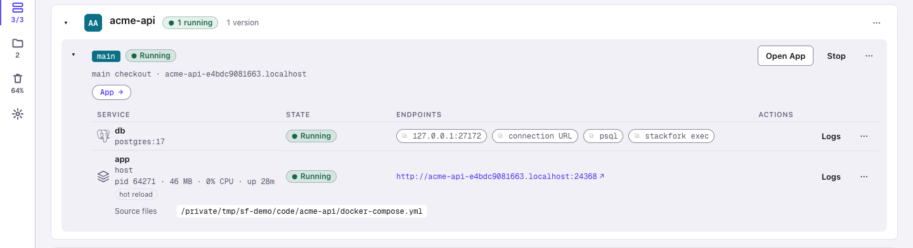
</picture>
</td>
<td width="50%">
<picture>
  <source media="(prefers-color-scheme: dark)" srcset="docs/screenshots/project-resources-dark.png">
  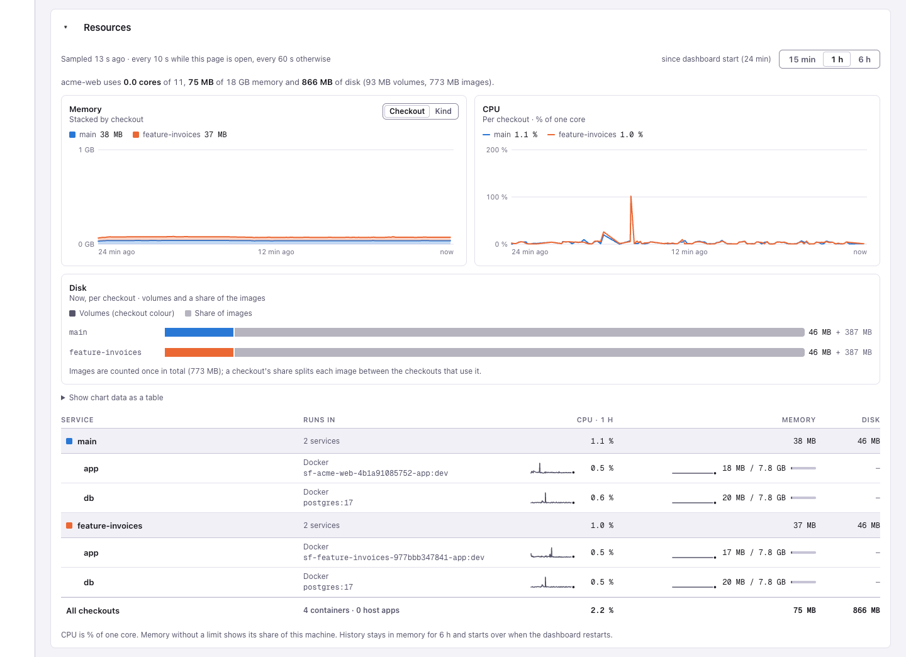
</picture>
</td>
</tr>
<tr>
<td><b>Instância híbrida:</b> o banco roda no Docker e o app roda no host com hot reload, com PID, memória e CPU à vista.</td>
<td><b>Recursos:</b> memória, CPU e disco de cada checkout, para você ver quanto cada cópia custa.</td>
</tr>
<tr>
<td width="50%">
<picture>
  <source media="(prefers-color-scheme: dark)" srcset="docs/screenshots/project-workflow-dark.png">
  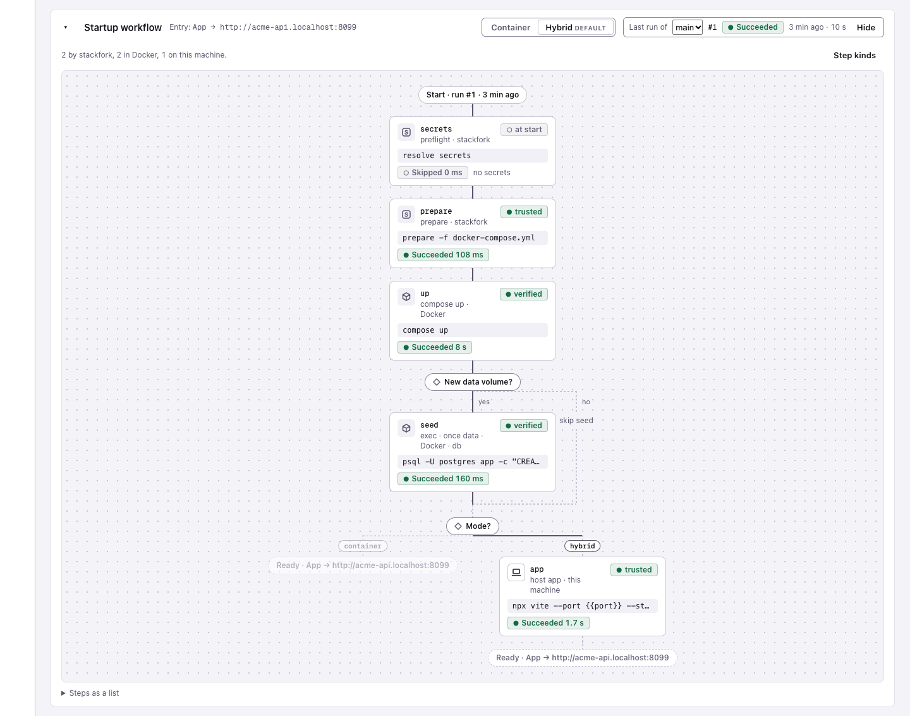
</picture>
</td>
<td width="50%">
<picture>
  <source media="(prefers-color-scheme: dark)" srcset="docs/screenshots/environment-dialog-dark.png">
  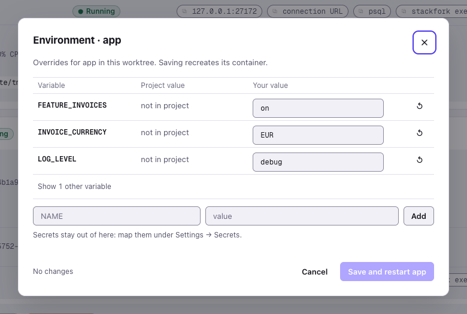
</picture>
</td>
</tr>
<tr>
<td><b>Fluxo de inicialização:</b> os passos gravados de um projeto, cada um com o resultado da última execução.</td>
<td><b>Ambiente:</b> mude uma variável só para um worktree, sem tocar no repositório.</td>
</tr>
</table>

## Por que os devs ficam com ele

| | |
|---|---|
| **Nada novo para manter** | Ele lê o arquivo Compose que você já mantém e nunca o edita. Se algo não puder ser isolado com segurança, ele aponta a linha. |
| **Hot reload e debugger, ainda isolados** | Deixe Postgres e Redis em contêineres e rode o app no host para ter hot reload e debugger. Cada branch continua com a sua própria cópia. |
| **Ambientes que acompanham seus pull requests** | `worktree add` + `start-env`, ou ligue o modo live e uma nova branch sobe sozinha. Faça o merge ou feche o pull request, e o ambiente some. GitOps, no seu notebook. |
| **Configure uma vez, para o time todo** | O plano de inicialização é um arquivo commitado. Colegas e agentes sobem o projeto do mesmo jeito, sempre. |
| **Agentes soltos, pessoas com as chaves** | Agentes iniciam, testam e param ambientes sozinhos. Apagar dados, confiar em comandos do host e ligar a automação esperam por uma pessoa. |
| **Continua rodando depois de reiniciar** | Apps no host passam por health check e são reiniciados. Depois de um reboot, o que rodava volta, e o que perdeu o banco para em vez de rodar contra o nada. |
| **Todas as cópias em um lugar só** | Um dashboard e um app de barra de menus do macOS mostram cada cópia em execução, suas URLs, memória e CPU, e por que uma inicialização falhou. |

## Instalação

Você precisa do Docker com o plugin Compose em execução. O stackfork suporta amd64 e arm64.

**macOS e Linux, com Homebrew**

```sh
brew trust pedropinheiro75/tap
brew install --cask pedropinheiro75/tap/stackfork
```

**macOS e Linux, com o script de instalação**

```sh
curl -fsSL https://raw.githubusercontent.com/pedropinheiro75/stackfork/main/install.sh | sh
```

**Windows, no PowerShell**

```powershell
irm https://raw.githubusercontent.com/pedropinheiro75/stackfork/main/install.ps1 | iex
```

Precisa do Docker Desktop com o backend WSL 2. O suporte a Windows é novo; leia [os limites no Windows](SECURITY.md#windows).

<details>
<summary>Outras formas de instalar</summary>

Baixe um binário na [página de Releases](https://github.com/pedropinheiro75/stackfork/releases).

Instale com Go 1.26.10 ou mais novo:

```sh
go install github.com/pedropinheiro75/stackfork/cmd/stackfork@latest
```

Compile a partir de um clone e coloque o binário no seu `PATH`:

```sh
go build -o stackfork ./cmd/stackfork
```

</details>

Confira a instalação:

```sh
stackfork version
```

O app de barra de menus do macOS é o `.dmg` da página de Releases. Veja [docs/macos-app.md](docs/macos-app.md).

## Como você usa

1. **Aponte o stackfork para a pasta do seu código.** Rode `stackfork dashboard --open`. Em **Settings**, adicione a pasta que guarda todos os seus projetos, por exemplo `~/code`.

<picture>
  <source media="(prefers-color-scheme: dark)" srcset="docs/screenshots/settings-folders-dark.png">
  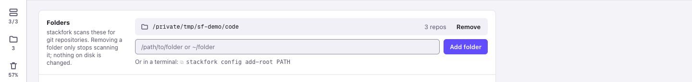
</picture>

2. **Clique em "Set up" e escolha seu agente.** Seu agente lê o projeto e salva como ele sobe. Isso acontece uma vez, para você, seu time e todos os agentes. Você também pode pedir ao seu agente: "aprenda este projeto com o stackfork". Mais em [learning.md](references/learning.md).

<picture>
  <source media="(prefers-color-scheme: dark)" srcset="docs/screenshots/learn-with-agent-dark.png">
  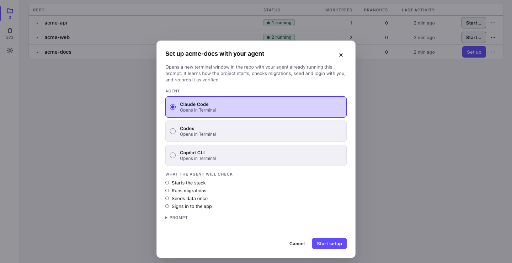
</picture>

3. **Peça um ambiente ao seu agente.** Por exemplo: "crie um ambiente do stackfork para a feature de faturas". Você recebe uma cópia completa do app para aquela branch. Você também pode apertar **Start** na página Repos.

<picture>
  <source media="(prefers-color-scheme: dark)" srcset="docs/screenshots/repos-dark.png">
  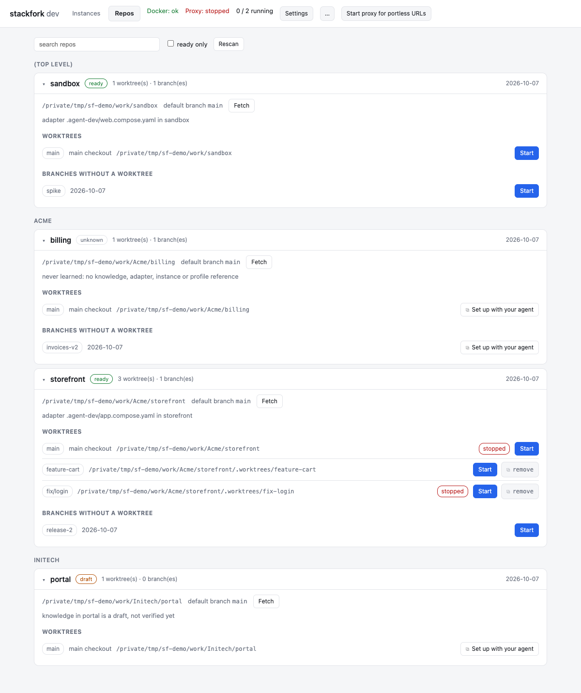
</picture>

4. **Abra.** Cada ambiente tem seu próprio endereço. Abra no navegador e compare lado a lado com a `main`.

<picture>
  <source media="(prefers-color-scheme: dark)" srcset="docs/screenshots/instances-two-checkouts-dark.png">
  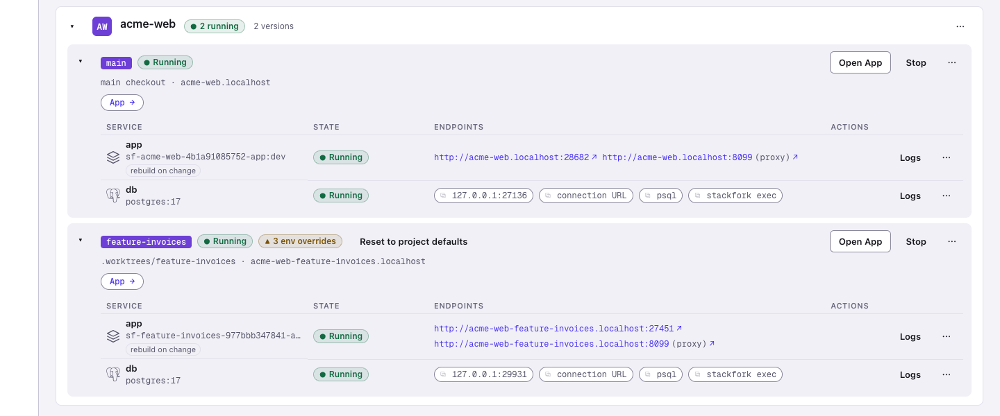
</picture>

<details>
<summary>Prefere o terminal?</summary>

Toda ação também existe como comando. Veja o passo a passo completo em [examples/node-postgres](examples/node-postgres/README.md) e todos os comandos em [references/commands.md](references/commands.md).

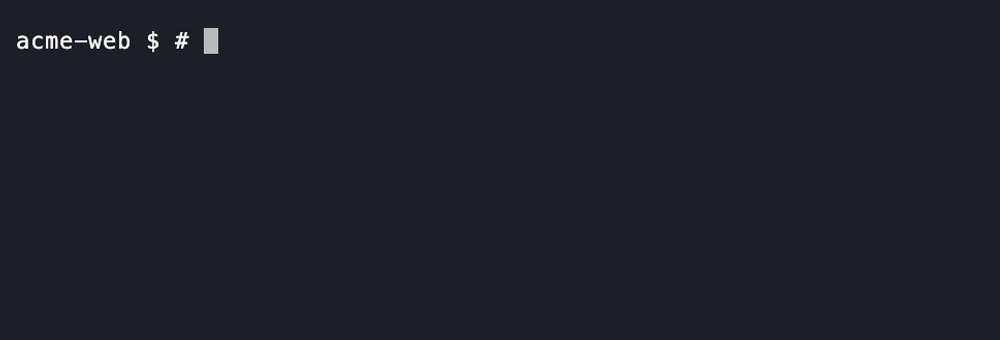

</details>

## Como funciona

- **Uma receita por projeto.** O que seu agente aprendeu fica em um arquivo no repositório. Ele diz como o projeto sobe, então ninguém precisa lembrar os passos.
- **Uma cópia por branch.** O stackfork sobe o mesmo projeto de novo para cada branch, com portas diferentes, um banco separado e uma rede separada. Ele lê o seu arquivo Docker Compose e nunca o edita.
- **Um endereço por cópia.** Um pequeno proxy local dá a cada cópia um nome terminado em `.localhost`, então você abre uma URL legível e não um número de porta.
- **O Git decide o que roda.** Uma branch ganha um ambiente, e um pull request mergeado ou fechado o tira. O stackfork vigia cada processo que iniciou e o traz de volta depois de uma reinicialização.
- **As pessoas ficam com as chaves.** Agentes podem iniciar, testar e parar ambientes. Apagar dados e confiar em novos comandos na sua máquina esperam por uma pessoa.

## O que você ganha

- **Acompanha seus pull requests.** Ligue o modo live em um repositório: uma nova branch sobe seu ambiente sozinha, cada push o atualiza e, quando o pull request é mergeado ou fechado, o ambiente é removido. Só uma pessoa pode ligar isso. [live](references/commands.md#live)
- **Docker, ou a sua máquina.** Deixe o banco no Docker e rode o app na sua máquina para ter hot reload e debugger. [host](references/commands.md#host)
- **Volta depois de reiniciar.** Depois de um reboot ou de um restart do Docker, o que rodava sobe de novo, sem apagar nem repopular o banco.
- **Uma configuração para uma branch.** Mude uma variável de ambiente em um único ambiente sem tocar no repositório. [env](references/commands.md#env)
- **Secrets ficam no seu chaveiro.** Senhas e tokens vêm do chaveiro do sistema ou do 1Password. O stackfork nunca os imprime. [secret](references/commands.md#secret)
- **Explica as falhas.** Cada inicialização é registrada passo a passo com seus logs, para você e seu agente verem o que quebrou. [worktrees.md](references/worktrees.md)
- **Diz não quando não é seguro.** Se um projeto não pode ser isolado com segurança, o stackfork se recusa e diz qual linha mudar. [adapting-compose.md](references/adapting-compose.md)

Mais screenshots em [docs/screenshots](docs/screenshots). Todos os comandos e flags: [references/commands.md](references/commands.md) ou `stackfork help`.

## Use com agentes de código

O repositório traz uma skill de agente (`SKILL.md` e `references/`) que ensina o fluxo: reaproveitar o que foi aprendido, preparar, iniciar, verificar, parar. Faça um link de um clone para o diretório de skills do seu agente:

```sh
mkdir -p ~/.claude/skills && ln -s "$(pwd)" ~/.claude/skills/stackfork   # Claude Code
mkdir -p ~/.codex/skills  && ln -s "$(pwd)" ~/.codex/skills/stackfork    # Codex
```

Depois peça ao agente com as suas palavras: "prepare este projeto em um novo worktree e teste a página de login". O Codex precisa que a skill seja citada pelo nome: `Use $stackfork para preparar este checkout com um ambiente de desenvolvimento isolado.`

Instale os guard hooks para que um agente não consiga iniciar um servidor de desenvolvimento no host, rodar um `docker compose up` puro em um checkout gerenciado nem apagar dados:

```sh
stackfork hooks install      # --tool claude|codex|copilot to choose one
stackfork hooks status
```

## Segurança

O stackfork isola os checkouts uns dos outros. Ele não é um sandbox: não protege você de um arquivo Compose malicioso e não acrescenta nada ao isolamento que o Docker já dá entre contêineres e host.

- Os guard hooks impedem que os agentes executem `down --volumes`, `reset`, `prune --yes`, `plan --trust`, `live on` e os comandos `secret`. É uma proteção para agentes cooperativos, não uma barreira de segurança.
- Comandos do host só rodam depois que uma pessoa confia no plano exato, por máquina. O dashboard só executa um comando que apaga dados depois que uma pessoa confirma em um diálogo nativo.
- `down` mantém os volumes. `prune` é uma simulação até receber `--yes`, toca só em objetos com label do stackfork e nunca roda `docker system prune`.
- Os valores dos secrets vêm do seu repositório de credenciais, aparecem como placeholders no dashboard e nos logs, e o `env set` os recusa.

O [SECURITY.md](SECURITY.md) traz o limite completo, as restrições conhecidas e como reportar uma vulnerabilidade.

## Por que não simplesmente...

| Em vez do stackfork | O que o stackfork faz de diferente |
|---|---|
| `docker compose -p BRANCH` à mão | Deriva o nome do projeto, as portas, os volumes e os nomes dos contêineres a partir do checkout, adiciona uma URL `.localhost` e ainda roda install, migrate, seed, apps no host e limpeza. |
| devcontainers | Lê o seu arquivo Compose como ele está. Foca nas colisões entre cópias paralelas, não em um ambiente reproduzível único. |
| Dagger, container-use | Outra camada: roda a sua stack existente, não constrói nem isola em sandbox por você. |
| Gerenciadores de worktree (Conductor e similares) | Complementa. Eles criam os worktrees; o stackfork torna a stack de cada um segura para rodar e lembra como. |
| Dokploy, Coolify | Eles servem a produção. O stackfork serve o notebook: muitas cópias de um projeto, para pessoas e agentes. |

## FAQ

**Preciso saber Docker?**
Você precisa do Docker rodando e de um projeto que já sobe com Docker Compose. Seu agente aprende o resto uma vez, e depois disso um novo ambiente é um pedido ou um clique.

**Ele muda o meu projeto?**
Ele adiciona uma pasta, `.stackfork/`, com a receita. Nunca edita o seu arquivo Compose. Se um projeto não pode ser isolado com segurança, o stackfork se recusa e diz qual linha mudar.

**Com quais agentes de IA ele funciona?**
Claude Code e Codex têm uma skill pronta. Claude Code, Codex e Copilot CLI têm guard hooks. Qualquer agente que consiga rodar um comando de terminal pode usar a CLI.

**Quantas cópias posso rodar ao mesmo tempo?**
Quantas a memória do seu computador aguentar. Cada cópia é um conjunto completo de contêineres, então um app pesado custa mais por branch. O dashboard mostra memória e CPU de cada cópia.

**É um sandbox?**
Não. O stackfork mantém as suas cópias separadas umas das outras, então duas branches nunca dividem uma porta nem um banco. Ele não é uma barreira de segurança contra código não confiável. Leia o [modelo de segurança](#segurança) e o [SECURITY.md](SECURITY.md).

**Alguma coisa sai da minha máquina?**
Não há telemetria nem conta. O dashboard escuta só em `127.0.0.1`. O stackfork só acessa a rede por meio do seu próprio `git` e `gh`, quando o modo live verifica uma branch ou um pull request.

## Roadmap

O que está planejado para os próximos passos. Ideias e votos são bem-vindos nas [Discussions](https://github.com/pedropinheiro75/stackfork/discussions).

- **Compartilhar um ambiente pela internet**: dê a alguém um link para uma branch rodando no seu notebook, atrás de uma camada de autenticação, para que nunca fique aberta a todos.
- **Traefik como proxy**: substituir o proxy embutido.
- **Teste de carga**: aponte uma ferramenta de teste de carga para qualquer ambiente.
- **Alertas de anomalia**: um aviso quando a CPU ou a memória de um app se comportar de forma anormal.
- **Mais stacks prontas**: receitas prontas para mais linguagens e frameworks, em Docker com hot reload. JavaScript e TypeScript vêm primeiro.
- **Um banco por branch, de verdade**: copie os dados da `main` para um novo ambiente, tire um snapshot antes de uma migration e restaure com um clique.
- **Servidor MCP**: qualquer agente encontra iniciar, logs, URLs e status como ferramentas, sem skill para instalar.
- **Dormir o que está parado**: pare um ambiente que ninguém abriu por um tempo e acorde-o na próxima requisição.
- **Notificações**: uma mensagem no sistema ou no Slack quando um ambiente ficar pronto, falhar ou for removido.
- **HTTPS local**: um certificado confiável para `*.localhost`, para testar cookies seguros, OAuth e service workers.
- **Abrir o pull request de um colega**: cole a URL do pull request e tenha o ambiente dele rodando, pronto para revisar.
- **Máquina remota**: rode os ambientes em um servidor de desenvolvimento via SSH e abra as URLs no seu notebook.
- **Outros runtimes de contêiner**: suporte testado e documentado para OrbStack, Colima e Podman.
- **Escolher repositórios à mão**: adicione um único repositório, ou esconda os que você não usa.

## Documentação

[references/](references/) · [SKILL.md](SKILL.md) · [SECURITY.md](SECURITY.md) · [CHANGELOG.md](CHANGELOG.md) · [CONTRIBUTING.md](CONTRIBUTING.md) · [LICENSE](LICENSE) (MIT)

**Dê a cada branch, e a cada agente, o seu próprio lugar para rodar.** Se o stackfork te poupou uma tarde de "port already in use", dê uma estrela no repositório e conte para a próxima pessoa que roda dois agentes em um notebook.
